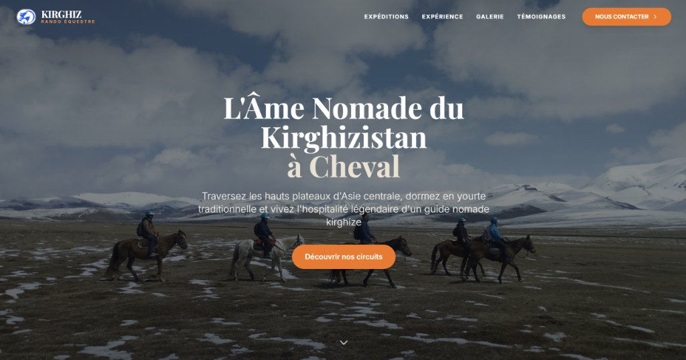
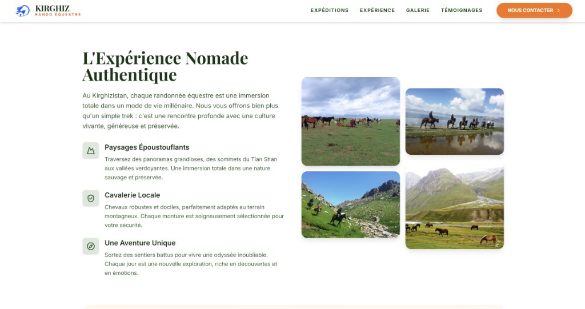
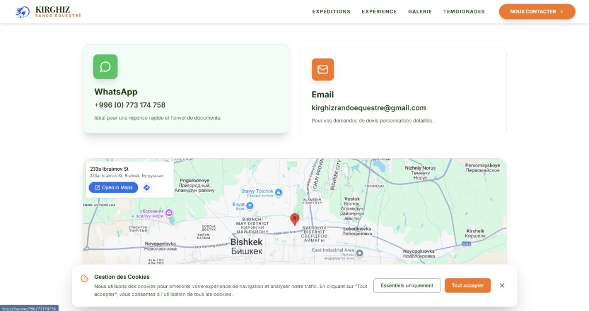
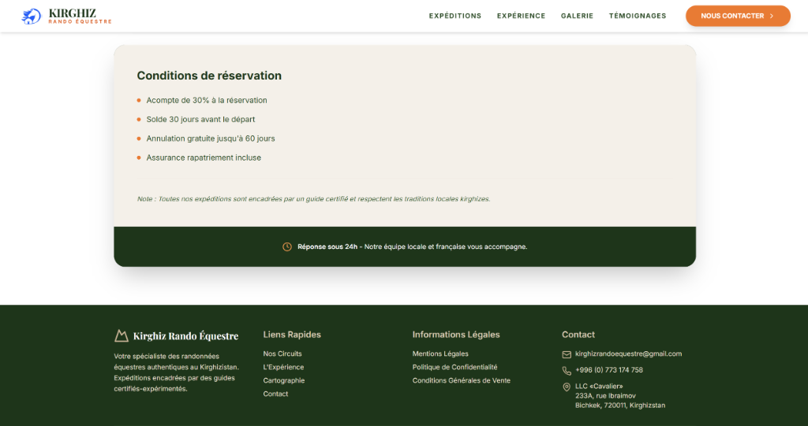

<div align="center">

# Kirghiz Rando Équestre

**Showcase & booking inquiry web application for a horseback trekking agency in Kyrgyzstan**

[](#english)
[](#français)
[](https://react.dev/)
[](https://www.typescriptlang.org/)
[](https://vitejs.dev/)
[](https://tailwindcss.com/)
[](https://www.netlify.com/)

</div>

---

<a id="english"></a>

## English

### Overview & Context

**Kirghiz Rando Équestre** (*LLC «Cavalier»*) is a responsive showcase website built for a local equestrian travel agency based in Bishkek, Kyrgyzstan, offering guided multi-day horseback expeditions across the Tian Shan mountains.

> **Project Context:** Built on request for a real client who needed an online presence to grow their trekking business. This project was created using an AI-assisted **vibe-coding** workflow for rapid UI/UX iteration, paired with hands-on customization to meet real business requirements—local photography and downloadable PDF itinerary integration, GDPR legal compliance, SEO metadata, and Netlify production deployment.

### Site Preview

*Screenshots shown in order of appearance from top to bottom on the website:*

<table>
  <tr>
    <td width="50%" valign="top">
      
      <br />
      <sub><strong>1. Hero &amp; Navigation</strong> — Full-screen landing banner with call-to-action and transparent sticky navbar.</sub>
    </td>
    <td width="50%" valign="top">
      
      <br />
      <sub><strong>2. Nomadic Experience</strong> — Agency pillars, 4-photo grid, and solid navbar state on scroll.</sub>
    </td>
  </tr>
  <tr>
    <td width="50%" valign="top">
      
      <br />
      <sub><strong>3. Contact, Map &amp; Cookies</strong> — Direct WhatsApp/Email cards, embedded Bishkek map, and GDPR consent banner.</sub>
    </td>
    <td width="50%" valign="top">
      
      <br />
      <sub><strong>4. Booking Terms &amp; Footer</strong> — Deposit/cancellation summary, 24h response bar, and legal modal links.</sub>
    </td>
  </tr>
</table>

### Features

- **Navigation & Hero (`Navbar`, `Hero`)**: Sticky header transitioning from transparent to solid white on scroll, responsive mobile drawer menu, smooth anchor scrolling, and a full-viewport hero banner with call-to-action.
- **Trust & Booking Policy (`TrustBadges`, `BookingInfo`)**: Reassurance strip (certified guide, secure payment, professional insurance) alongside a dismissible deposit/cancellation policy bar with a floating restore button.
- **Agency Story & Guide Profile (`About`, `NomadicExperience`)**: Local agency history (founded in 2016), eco-tourism pillars, a 4-photo nomadic lifestyle grid, and a dedicated biography card for certified French-speaking guide *Nurlan Akparaliev*.
- **Expeditions Catalog & Detail Modal (`Expeditions`, `ExpeditionModal`, `expeditionsData`)**: 4 horseback circuits (10 to 19 days, *Modéré* to *Expert*) with difficulty badges, an interactive detail modal (description, photo gallery, inclusions), and **direct downloadable PDF itineraries** (`public/pdfs/`). *(Also includes a standalone `InteractiveMap` SVG component with hover tooltips and altitude/climate stats.)*
- **Photo Gallery & Lightbox (`Gallery`)**: 6-image preview grid with hover captions expanding into a 9-photo fullscreen lightbox with previous/next arrow controls and pagination dots.
- **Client Testimonials Carousel (`Testimonials`)**: Paginated 3-column slider displaying 5-star rider reviews with navigation arrows and pagination indicators.
- **Direct Contact & Location (`ContactForm`)**: Zero-friction **WhatsApp** (`wa.me`) and **Email** (`mailto:`) action cards, embedded **Google Maps** (Bishkek, Kyrgyzstan), and booking terms summary.
- **GDPR Compliance & SEO (`CookieBanner`, `LegalModal`, `Footer`, `index.html`)**: `localStorage`-persisted cookie consent banner, tabbed legal modal (*Mentions Légales*, *GDPR Privacy Policy*, *Terms of Sale*), Open Graph / Twitter Card tags, and a custom Tailwind theme (`forest`, `sand`, `earth`) with `Playfair Display` & `Inter` fonts.

### Tech Stack & Quick Start

| Layer | Technology |
| :--- | :--- |
| **UI & Language** | React 18.3, TypeScript 5.5, Lucide React |
| **Styling** | Tailwind CSS 3.4 (custom `forest`, `sand`, `earth` palette) |
| **Build & Tooling** | Vite 5.4, ESLint 9, PostCSS |
| **Deployment** | Netlify (`netlify.toml` -> `npm run build` -> `dist/`) |

```bash
npm install          # Install dependencies
npm run dev          # Start dev server (http://localhost:5173)
npm run typecheck    # Run TypeScript type checking
npm run lint         # Run ESLint
npm run build        # Build for production (dist/)
```

---

<a id="français"></a>

## Français

### Présentation & Contexte

**Kirghiz Rando Équestre** (*LLC «Cavalier»*) est un site vitrine responsive conçu pour une agence locale de voyages équestres basée à Bichkek, au Kirghizistan, spécialisée dans les expéditions guidées à cheval à travers les montagnes du Tian Shan.

> **Contexte du projet :** Réalisé à la demande d'un client qui avait besoin d'un site web pour développer son activité de randonnées équestres. Le projet a été développé en **vibe-coding** (développement assisté par IA) afin d'itérer rapidement sur le design et l'ergonomie, puis adapté et finalisé pour répondre aux besoins métier concrets : intégration des photos et programmes PDF téléchargeables, conformité RGPD, métadonnées SEO et configuration pour déploiement Netlify.

### Aperçu du site

*Captures présentées dans l'ordre d'apparition du haut vers le bas du site :*

<table>
  <tr>
    <td width="50%" valign="top">
      
      <br />
      <sub><strong>1. Accueil &amp; Navigation</strong> — Bannière plein écran avec appel à l'action et barre de navigation transparente.</sub>
    </td>
    <td width="50%" valign="top">
      
      <br />
      <sub><strong>2. Expérience Nomade</strong> — Valeurs de l'agence, grille de 4 photos et barre de navigation fixe au défilement.</sub>
    </td>
  </tr>
  <tr>
    <td width="50%" valign="top">
      
      <br />
      <sub><strong>3. Contact, Carte &amp; Cookies</strong> — Cartes WhatsApp/Email directes, carte de Bichkek intégrée et bannière RGPD.</sub>
    </td>
    <td width="50%" valign="top">
      
      <br />
      <sub><strong>4. Réservation &amp; Pied de page</strong> — Conditions d'acompte/annulation, délai de réponse 24h et liens légaux.</sub>
    </td>
  </tr>
</table>

### Fonctionnalités

- **Navigation & Accueil (`Navbar`, `Hero`)** : Barre de navigation fixe évoluant de transparente à opaque au défilement, menu mobile rétractable, défilement fluide par ancres et bannière d'accueil plein écran avec appel à l'action.
- **Réassurance & Réservation (`TrustBadges`, `BookingInfo`)** : Bandeau de confiance (guide certifié, paiement sécurisé, assurance professionnelle) et barre d'information rétractable sur les conditions d'acompte et d'annulation avec bouton flottant de réouverture.
- **Histoire & Expérience Nomade (`About`, `NomadicExperience`)** : Présentation de l'agence (créée en 2016), engagements d'écotourisme, grille photo sur la culture nomade et fiche biographique du guide francophone certifié *Nurlan Akparaliev*.
- **Catalogue d'Expéditions & Modale (`Expeditions`, `ExpeditionModal`, `expeditionsData`)** : 4 circuits équestres (10 à 19 jours, niveaux *Modéré* à *Expert*) avec badges de difficulté, modale détaillée (description, galerie secondaire, prestations incluses) et **téléchargement direct des programmes en PDF** (`public/pdfs/`). *(Contient également un composant modulaire `InteractiveMap` en SVG avec infobulles au survol et statistiques d'altitude/climat.)*
- **Galerie Photo & Lightbox (`Gallery`)** : Grille d'aperçu de 6 photos avec légendes au survol ouvrant une lightbox plein écran de 9 photos équipée de flèches de navigation et de points de pagination.
- **Carrousel de Témoignages (`Testimonials`)** : Slider paginé affichant 3 avis clients 5 étoiles par page avec flèches directionnelles et indicateurs de pagination.
- **Contact Direct & Carte (`ContactForm`)** : Cartes de contact direct vers **WhatsApp** (`wa.me`) et **Email** (`mailto:`), carte **Google Maps** intégrée (Bichkek, Kirghizistan) et récapitulatif des conditions de réservation.
- **Conformité RGPD & SEO (`CookieBanner`, `LegalModal`, `Footer`, `index.html`)** : Bannière de consentement aux cookies persistée dans `localStorage`, modale légale complète (*Mentions Légales*, *Politique de Confidentialité RGPD*, *Conditions Générales de Vente*), balises Open Graph / Twitter Card et palette Tailwind sur mesure (`forest`, `sand`, `earth`) avec polices `Playfair Display` & `Inter`.

### Structure & Lancement Rapide

```text
KirghizRando/
├── docs/screenshots/    # Captures d'aperçu pour le README
├── public/
│   ├── images/          # Visuels du site, galerie, expéditions et Open Graph
│   └── pdfs/            # Programmes détaillés téléchargeables des 4 circuits
├── src/
│   ├── components/      # Composants UI (Navbar, Hero, Expeditions, Gallery, LegalModal, etc.)
│   ├── data/            # Catalogue et coordonnées des circuits (expeditionsData.ts)
│   └── App.tsx          # Assemblage principal de la page
├── index.html           # Métadonnées SEO & Google Fonts
└── netlify.toml         # Configuration de build Netlify (dist/)
```

```bash
npm install          # Installer les dépendances
npm run dev          # Lancer le serveur de développement (http://localhost:5173)
npm run typecheck    # Vérifier le typage TypeScript
npm run lint         # Analyser le code avec ESLint
npm run build        # Compiler pour la production (dist/)
```
